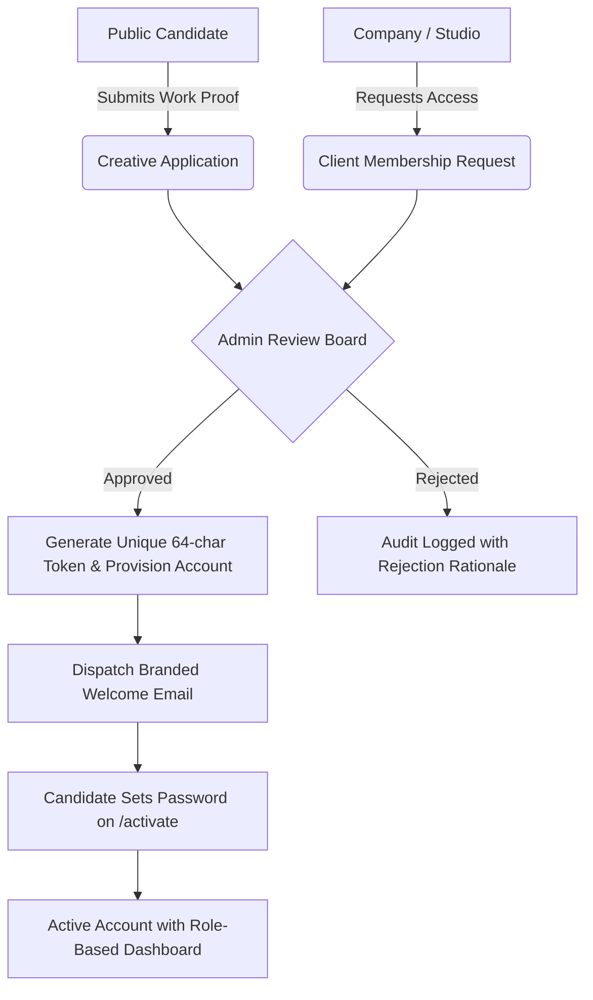

# Ze: Creatives — Curated Creative Talent Marketplace

> **A production-ready full-stack creative marketplace connecting ambitious clients with handpicked, world-class creative professionals across design, 3D, film, and art direction.**

---

## 🎨 Visual Identity & Design System

The visual identity follows an editorial, high-craft creative aesthetic tailored to premier agencies and artists:

| Token | Hex | Role |
|---|---|---|
| **Primary Brand Purple** | `#7957F5` | Main CTAs, active highlights, key brand accents |
| **Secondary Lavender** | `#E9DFFF` | Subtle pill tags, selected filters, hover backgrounds |
| **Blush Accent** | `#F8E7F0` | Special category tags, featured highlight badges |
| **Deep Charcoal** | `#171526` | High-contrast typography and dark surfaces |
| **Muted Slate** | `#777386` | Secondary body text, captions, and metadata |
| **Soft Surface** | `#FCFAFF` | Clean off-white canvas and background container |
| **Subtle Border** | `#EEEAF5` | Hairline dividers, card outlines, form strokes |

---

## 🏗️ System Architecture

```
ze creatives/
├── frontend/                     # Next.js (App Router) + TypeScript + Tailwind CSS
│   ├── app/                      # Route Groups: (public), (auth), (dashboard)
│   │   ├── (public)/             # Public pages (Landing, Jobs, Creatives, Apply)
│   │   ├── (auth)/               # Sign-in, Activate Account, Password Reset
│   │   └── (dashboard)/          # Admin, Creative, and Client Control Centers
│   ├── components/               # Reusable UI & Layout Components
│   │   ├── ui/                   # Buttons, Badges, Inputs, Cards, Modals
│   │   └── layout/               # Navbar with role-based navigation & Footer
│   ├── lib/                      # Axios API client with auto-refresh JWT tokens
│   ├── store/                    # Zustand persistent auth state
│   └── types/                    # Domain TypeScript interfaces
├── backend/                      # FastAPI + SQLAlchemy 2.0 (Async) + Pydantic v2
│   ├── app/
│   │   ├── api/v1/               # Fully implemented modular REST endpoints
│   │   │   ├── auth.py           # JWT auth, token rotation, activation flow
│   │   │   ├── public.py         # Unauthenticated jobs, creatives & categories
│   │   │   ├── creative_applications.py # Creative vetting & review queue
│   │   │   ├── client_applications.py   # Client membership review queue
│   │   │   ├── creative_profiles.py     # 7-step onboarding & portfolio sync
│   │   │   ├── client_profiles.py       # Organisation profile & workspace
│   │   │   ├── jobs.py           # Multi-step job posting & publishing
│   │   │   ├── job_applications.py      # Candidate review pipeline
│   │   │   ├── portfolio.py      # Media & case study management
│   │   │   ├── messaging.py      # Direct collaboration messaging
│   │   │   ├── notifications.py  # In-app notification system
│   │   │   ├── categories.py     # 20+ creative disciplines taxonomy
│   │   │   ├── skills.py         # Searchable technical skills
│   │   │   ├── subscriptions.py  # Tiered subscription management
│   │   │   ├── users.py          # Super Admin user CRUD & RBAC
│   │   │   └── admin.py          # Platform audit logs & metrics
│   │   ├── core/                 # App config, security helpers, RBAC dependencies
│   │   ├── models/               # 30+ relational database models
│   │   ├── schemas/              # Strongly-typed request/response validation
│   │   └── services/             # Email dispatching & storage abstractions
│   ├── requirements.txt          # Python dependencies
│   └── Dockerfile                # Production backend container definition
├── docker-compose.yml            # Multi-service setup (PostgreSQL, Redis, MinIO, Backend, Frontend)
└── .env.example                  # Environment configuration template
```

---

## 🔐 Account Governance & The Invite-Only Pipeline

Unlike generic open-registration platforms, **Ze: Creatives** maintains an uncompromising standard of craft:



---

## ⚡ Quickstart & Local Setup

### 1. Prerequisites
- **Node.js**: v20+ or v22+
- **Python**: 3.12+
- **Docker & Docker Compose** (optional for one-click stack)

### 2. Using Docker Compose (Full Stack)
```bash
# Clone and enter directory
cd "ze creatives"

# Copy environment variables
cp .env.example .env

# Launch PostgreSQL 16, Redis 7, MinIO S3, FastAPI backend, and Next.js frontend
docker compose up -d

# Seed super admin and creative categories
docker compose exec backend python -m app.db.seed
```

### 3. Running Manually

#### Backend:
```bash
cd backend
python -m venv venv
# Windows:
.\venv\Scripts\activate
# macOS/Linux:
source venv/bin/activate

pip install -r requirements.txt
uvicorn app.main:app --reload --port 8000
```
Interactive API documentation will be accessible at: `http://localhost:8000/docs`

#### Frontend:
```bash
cd frontend
npm install --legacy-peer-deps
npm run dev
```
Access the application at: `http://localhost:3000`

---

## 🔑 Default Seed Credentials for Evaluation

The database seeder provisions initial test accounts:

| Role | Email | Password | Access |
|---|---|---|---|
| **Super Admin** | `admin@zecreatives.com` | `AdminZe2026!` | Full platform moderation, vetting queues, audit logs |
| **Verified Creative** | `elena@zecreatives.com` | `CreativeZe2026!` | Creative dashboard, application tracker, portfolio manager |
| **Verified Client** | `client@zecreatives.com` | `ClientZe2026!` | Client workspace, job poster, applicant review pipeline |

---

## 🛡️ Role-Based Access Control (RBAC) Matrix

| Endpoint / Page | Public | Creative | Client | Super Admin |
|---|:---:|:---:|:---:|:---:|
| Browse Jobs (`/jobs`) | ✅ | ✅ | ✅ | ✅ |
| Browse Creatives (`/creatives`) | ✅ | ✅ | ✅ | ✅ |
| Submit Creative Application (`/apply/creative`) | ✅ | — | — | — |
| Request Client Access (`/apply/client`) | ✅ | — | — | — |
| Apply for Role (`POST /jobs/{id}/apply`) | ❌ | ✅ | ❌ | ❌ |
| Post & Publish Job (`POST /jobs`) | ❌ | ❌ | ✅ | ✅ |
| Review Applicants & Shortlist | ❌ | ❌ | ✅ | ✅ |
| Manage Portfolio & Case Studies | ❌ | ✅ | ❌ | ✅ |
| Approve / Reject Creative Applications | ❌ | ❌ | ❌ | ✅ |
| Approve / Reject Client Access | ❌ | ❌ | ❌ | ✅ |
| User Suspension & Moderation | ❌ | ❌ | ❌ | ✅ |
| View System Audit Logs | ❌ | ❌ | ❌ | ✅ |
